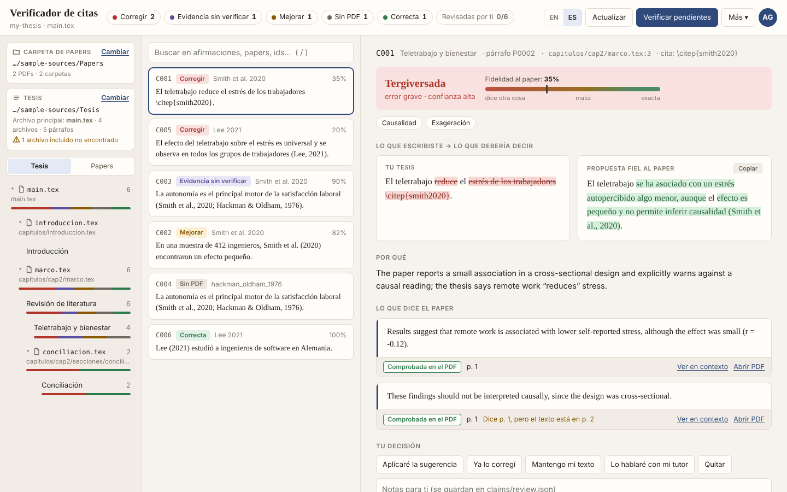
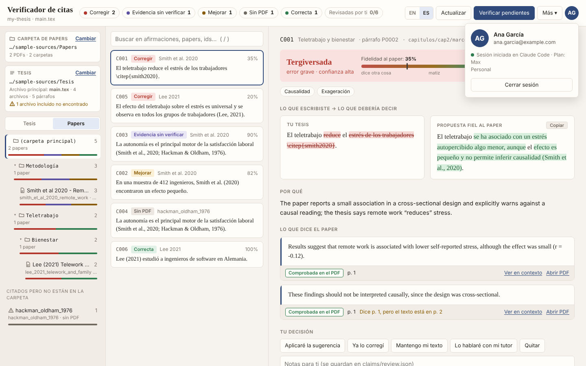

# Thesis Citation Checker (verificador de citas de tesis)

[English](README.md) · **Español**

Comprueba, paper por paper, si lo que tu tesis dice de cada fuente está realmente respaldado por ella.
Funciona dentro de [Claude Code](https://docs.claude.com/en/docs/claude-code/overview) con **tu propia
suscripción de Claude** (sin clave de API) e incluye un visor local bilingüe (inglés/español) donde eliges
tus carpetas, inicias sesión en Claude y revisas cada cita.

Cada veredicto viene con una **cita literal del paper y su página**. Un script sin IA comprueba que esa
cita existe de verdad en el PDF, así que nunca tienes que fiarte de evidencia inventada.



## Cómo funciona

```
tu carpeta de papers ─┐                            ┌─> results/<paper>.json ─┐
 (con subcarpetas)    ├─ /cite-init ─ /cite-claims ─┤   (1 subagente por paper) ├─> check_quotes.py ─> visor + reports/
tu carpeta de tesis  ─┘    texto     afirmaciones   └──────────────────────────┘    (sin IA)
 (main.tex + \input/\include)
```

1. **`/cite-init`** extrae el texto de cada PDF de tu carpeta de papers y sus subcarpetas (con marcas de
   página), lee tu tesis (siguiendo cada `\input`, `\include` y `\subfile` desde el `.tex` principal) y
   numera sus párrafos.
2. **`/cite-claims`** lee la tesis y registra en `claims/claims.csv` cada afirmación que cita una fuente,
   una fila por afirmación y paper. Después comprueba que no quedó ninguna cita sin registrar.
3. **`/cite-verify`** lanza un **subagente verificador por paper**. Cada uno ve solo ese paper y las
   afirmaciones que lo citan (nunca el resto de la tesis), lee el texto completo y devuelve, para cada afirmación:
   - un **veredicto**: correcta, parcial, tergiversada, no encontrada o no verificable;
   - su **fidelidad** al paper (0–100 %), la **gravedad** del error y los **tipos de error**
     (causalidad, generalización, exageración, dato incorrecto, falta un matiz, cita secundaria…);
   - 1–3 **citas literales** con su página;
   - una explicación y la **frase reescrita** fiel al paper, lista para pegar.
4. **`check_quotes.py`** (sin IA) busca cada cita en el texto del PDF. Si un veredicto "correcta" se apoya
   en una cita que no está, la afirmación se marca como **evidencia sin verificar**.
5. **El visor** y los **reportes en Excel y Markdown** lo muestran todo, con los problemas más graves primero.

## Requisitos
- [Claude Code](https://docs.claude.com/en/docs/claude-code/overview) con la sesión iniciada con tu cuenta
  de Claude (plan Pro o Max). Usa el uso de tu plan, no tokens de la API. Verificar decenas de papers
  completos puede llevarte a los límites del plan, así que conviene ir por tandas (por sección, por ejemplo).
- Python 3.10 o superior.

## Primeros pasos
1. Clona o descarga este repositorio.
2. Abre el visor: doble clic en **`open-viewer.bat`** (Windows) o **`open-viewer.command`** (macOS),
   o ejecuta `python scripts/viewer.py`. Elige el idioma con el selector **EN / ES**.
3. **Inicia sesión en Claude** con el botón de arriba a la derecha (ver [Tu cuenta de Claude](#tu-cuenta-de-claude)).
4. En el panel izquierdo, **elige tu carpeta de papers**. Puede estar en cualquier lugar de tu ordenador, se
   incluyen las subcarpetas y tus archivos conservan sus nombres. Después **elige la carpeta de tu tesis**: un
   proyecto LaTeX (se detecta el `.tex` principal; si hay varios, eliges uno) o una carpeta con un .docx/.md/.txt.
5. Pulsa **Más ▾ → Preparar proyecto** (completa autores, años y títulos) y luego **Extraer afirmaciones de la tesis**.
6. Revisa `claims/claims.csv` en Excel (ver el consejo de abajo) y pulsa **Verificar pendientes**.

> **Consejo:** `claims/claims.csv` es la base de todo. Si una afirmación queda mal recortada o asignada
> al paper equivocado, su veredicto también lo estará. Revísalo antes de verificarlo todo.

## El visor
Una página en `http://localhost:8765` que solo existe en tu ordenador (el servidor escucha en `127.0.0.1`).



- **Selectores de carpeta** para tus papers y tu tesis: el diálogo de carpetas de tu sistema o, si no está
  disponible, un explorador de carpetas integrado. Al cambiar una carpeta se relee al instante (sin IA).
- **Pestaña Tesis:** la estructura de tu tesis tal como la lee Claude: `.tex` principal → archivos incluidos →
  capítulos → secciones, cada nivel con su número de afirmaciones y una barra de colores. Pulsa cualquier nivel
  para filtrar las afirmaciones. Se avisa de los archivos incluidos que no se encontraron.
- **Pestaña Papers:** tu carpeta de papers como un árbol de subcarpetas y PDFs, más los papers que tu tesis
  cita pero que no están en la carpeta.
- Cada afirmación muestra el archivo y la línea de donde viene (p. ej. `capitulos/revision.tex:42`).
- Para cada afirmación: veredicto, medidor de **fidelidad**, **gravedad** y **tipos de error** (pasa el ratón para ver qué significan).
- **Lo que escribiste → lo que debería decir**, con los cambios marcados palabra a palabra y un botón para copiar.
- Las citas literales del paper, si cada una se encontró en el PDF, y un enlace a esa página exacta,
  resaltada en contexto o en el propio PDF.
- Registra **tu decisión** (aplicaré la sugerencia, ya lo corregí, mantengo mi texto, lo hablaré con mi tutor)
  y notas. Se guardan en `claims/review.json`.
- Botones para **Verificar pendientes**, **Re-verificar un paper** y **Pedir segunda opinión**. Ejecutan
  Claude Code en segundo plano (`claude -p`) con tu cuenta, y el avance se ve en vivo.
- Atajos: `j`/`k` para moverte entre afirmaciones, `/` para buscar y `r` para recargar.

El selector de idioma también guarda `language` en `config.json`. Claude lo lee, así que sus mensajes y
explicaciones salen en ese idioma.

## Tu cuenta de Claude
El círculo de arriba a la derecha muestra quién tiene la sesión iniciada en Claude Code en este ordenador
(iniciales, nombre, correo y plan). Desde ahí puedes **cerrar sesión** y, si no hay nadie, **Iniciar sesión
en Claude** lanza el inicio de sesión oficial (`claude auth login`): se abre una pestaña de claude.ai, inicias
sesión y autorizas, y si la página te muestra un código lo pegas en el visor. El visor nunca ve tu contraseña;
solo ejecuta `claude auth status`, `claude auth login` y `claude auth logout`. Las verificaciones siempre se
hacen con la cuenta que aparece ahí.

## Papers con el mismo nombre
Las claves salen de los nombres de archivo (`Smith et al 2020.pdf` → `smith_et_al_2020`) y se listan en
`claims/papers.csv`. Las copias idénticas de un PDF en distintas subcarpetas cuentan como un solo paper. Los PDFs
distintos con el mismo nombre reciben una huella corta de su contenido, así que las claves no cambian aunque
muevas archivos o elijas otra carpeta.

## Comandos (dentro de Claude Code)
| Comando | Qué hace |
|---|---|
| `/cite-init` | Instala dependencias, extrae el texto de PDFs y tesis y completa `claims/papers.csv` (autores, año, título). |
| `/cite-claims [sección]` | Registra cada afirmación con cita en `claims/claims.csv`. Conserva los ids de las que no cambiaron. |
| `/cite-verify pending` | Un subagente verificador por paper pendiente. También `/cite-verify smith2020`, `/cite-verify section 2.3`, `/cite-verify all`. |
| `/cite-report` | Recomprueba todas las citas y regenera `reports/report.xlsx` y `reports/report.md`. |
| `/cite-review C014` | Segunda opinión sobre una afirmación, con redacciones alternativas. |
| `/cite-status` | Qué falta: papers pendientes, sin PDF o que necesitan OCR. |
| `/cite-viewer` | Abre el visor. |

## Veredictos
| Veredicto | Acción | Significado |
|---|---|---|
| correcta | OK | El paper la respalda tal como está escrita. |
| parcial | MEJORAR | Idea correcta, pero falta un matiz, exagera algo o un dato menor no cuadra. |
| tergiversada | CORREGIR | El paper dice algo distinto, más débil u opuesto. |
| no encontrada | CORREGIR | Nada en el paper la respalda. |
| no verificable | REVISAR A MANO | Texto insuficiente (PDF escaneado, solo resumen). |

Además:
- **Evidencia sin verificar:** la IA dijo "correcta" o "parcial", pero su cita no está en el PDF. No te fíes.
- **Cita secundaria:** el paper solo menciona la idea citando a otro autor. Probablemente deberías citar la fuente original.

## Cuándo volver a ejecutarlo
- **Cambiaste la tesis:** edítala en su carpeta, pulsa **Actualizar**, ejecuta `/cite-claims` (conserva los ids
  de lo que no cambió) y luego `/cite-verify pending`.
- **Añadiste papers:** ponlos en cualquier lugar de tu carpeta de papers, pulsa **Actualizar** (o **Más ▾ →
  Volver a escanear carpetas**) y luego `/cite-verify pending`.

## PDFs escaneados (OCR)
Si `/cite-init` avisa de un PDF sin texto, pásalo por OCR antes. Por ejemplo, con
[OCRmyPDF](https://ocrmypdf.readthedocs.io):
```
ocrmypdf --skip-text "Autor 2015.pdf" "Autor 2015.pdf"
```
Después vuelve a ejecutar `/cite-init`.

## Ahorrar uso del plan
- Verifica por secciones (`/cite-verify section ...`) en vez de todo a la vez.
- El subagente usa el modelo de tu sesión. Para gastar menos, cambia `model: inherit` por `model: sonnet`
  en `.claude/agents/verifier.md` (algo menos fino detectando matices).
- `/cite-verify pending` nunca repite papers ya verificados.

## Estructura
```
config.json    idioma y rutas de tus carpetas de papers y tesis
papers/        carpeta de papers por defecto, opcional (puedes elegir cualquier otra)
thesis/        carpeta de tesis por defecto, opcional (puedes elegir cualquier otra)
extracted/     generado: texto de cada PDF, la tesis en orden de lectura, su estructura y las citas detectadas
claims/        papers.csv (índice de papers), claims.csv (una fila por afirmación y paper), review.json (tus decisiones)
results/       un JSON de veredictos por paper
reports/       report.xlsx y report.md
scripts/       Python sin IA (viewer.py sirve la página local)
viewer/        la página del visor
tests/         pruebas unitarias de los scripts
.claude/       comandos /cite-* y el subagente verificador
CLAUDE.md      instrucciones del proyecto para Claude Code
```

## Desarrollo
```
python -m pip install -r requirements.txt
python -m unittest discover -s tests -v
```
Los scripts solo usan la librería estándar más `pypdf`, `python-docx` y `openpyxl`.
`pymupdf` y `rapidfuzz` (en `requirements-extra.txt`) son opcionales y mejoran la calidad.

## Privacidad
`.gitignore` excluye tus papers, tu tesis, el texto extraído, los resultados y los reportes, así que puedes
subir tu copia del repositorio a GitHub sin publicar tu material. Los papers y la tesis que tengas en carpetas
fuera del proyecto nunca se modifican: los scripts solo los leen. Al verificar, el texto de los papers y de
las afirmaciones se envía a Claude, como en cualquier sesión de Claude Code.

## Limitaciones
- "p. N" es la página del PDF, que puede no coincidir con la numeración de la revista.
- La extracción de texto puede perder tablas y figuras. Revisa a mano las afirmaciones que dependan de una tabla.
- Es una herramienta de apoyo: la decisión final sobre cada cita es tuya.
