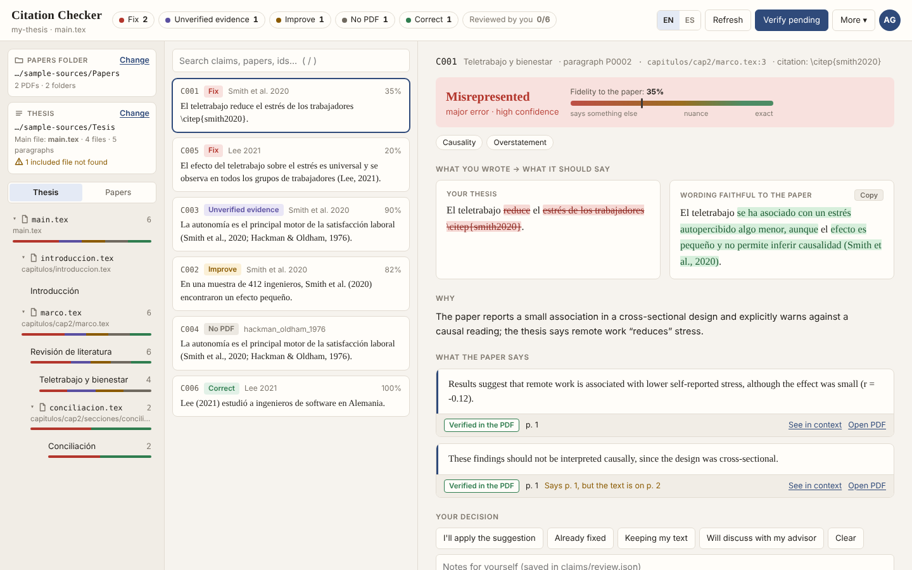
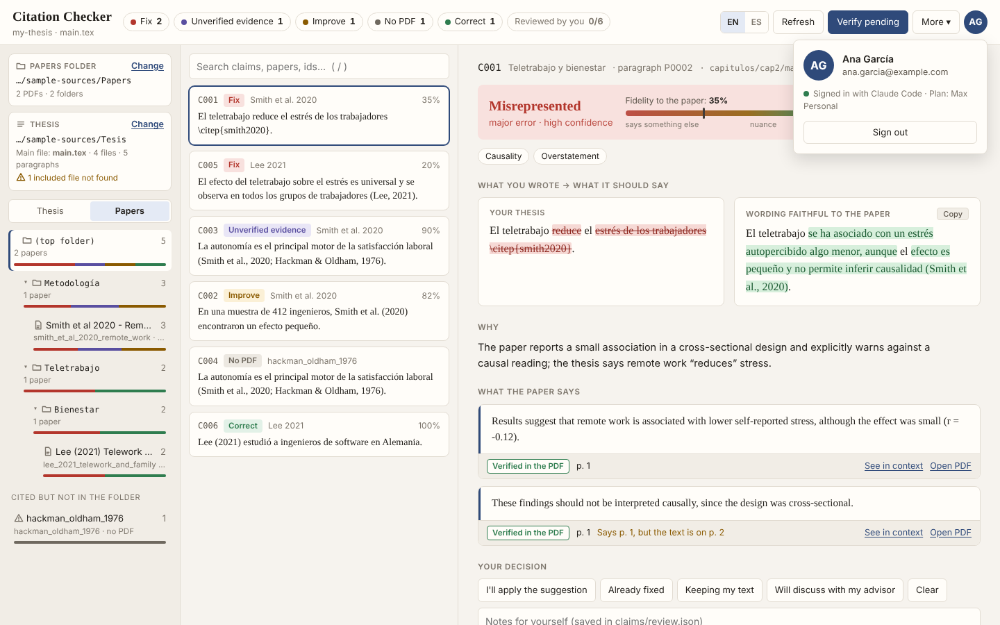

# Thesis Citation Checker

**English** · [Español](README.es.md)

Check, paper by paper, whether what your thesis says about each source is actually supported by it.
Runs inside [Claude Code](https://docs.claude.com/en/docs/claude-code/overview) with **your own Claude
subscription** (no API key needed), and comes with a local, bilingual (English/Spanish) viewer where you
pick your folders, sign in to Claude and review every citation.

Every verdict comes with a **verbatim quote from the paper and its page**, and a script that uses
no AI checks that the quote really exists in the PDF, so you never have to trust invented evidence.



## How it works

```
your papers folder ─┐                            ┌─> results/<paper>.json ─┐
 (with subfolders)  ├─ /cite-init ─ /cite-claims ─┤   (1 subagent per paper) ├─> check_quotes.py ─> viewer + reports/
your thesis folder ─┘   text         claims       └──────────────────────────┘    (no AI)
 (main.tex + \input/\include)
```

1. **`/cite-init`** extracts the text of every PDF in your papers folder and its subfolders (with page
   markers), reads your thesis (following every `\input`, `\include` and `\subfile` from the main `.tex`)
   and numbers its paragraphs.
2. **`/cite-claims`** reads the thesis and records every claim that cites a source in `claims/claims.csv`,
   one row per (claim, paper), then checks that no detected citation was left out.
3. **`/cite-verify`** launches one **verifier subagent per paper**. Each one sees only that paper and
   the claims that cite it (never the rest of the thesis), reads the full text and returns, per claim:
   - a **verdict**: correct, partial, misrepresented, not found or unverifiable;
   - its **fidelity** to the paper (0–100 %), the error **severity** and the **error types**
     (causality, overgeneralization, overstatement, wrong data, missing nuance, secondary citation…);
   - 1–3 **verbatim quotes** with their page;
   - an explanation and a **rewritten sentence** faithful to the paper, ready to paste.
4. **`check_quotes.py`** (no AI) looks for every quote in the PDF text. If a "correct" verdict rests
   on a quote that is not there, the claim is flagged as **unverified evidence**.
5. **The viewer** and the **Excel/Markdown reports** show everything, with the worst problems first.

## Requirements
- [Claude Code](https://docs.claude.com/en/docs/claude-code/overview), signed in with your Claude account
  (Pro or Max plan). It uses your plan's usage, not API tokens. Verifying dozens of full papers can hit
  your plan's limits, so work in batches (by section, for example).
- Python 3.10 or newer.

## Getting started
1. Clone or download this repository.
2. Open the viewer: double-click **`open-viewer.bat`** (Windows) or **`open-viewer.command`** (macOS),
   or run `python scripts/viewer.py`. Pick your language with the **EN / ES** switch.
3. **Sign in to Claude** with the button at the top right (see [Your Claude account](#your-claude-account)).
4. In the left panel, **choose your papers folder**. It can be anywhere on your computer, subfolders are
   included, and your files keep their names. Then **choose your thesis folder**: a LaTeX project (the main
   `.tex` is detected; if there are several, pick one) or a folder with a .docx/.md/.txt file.
5. Click **More ▾ → Prepare project** (fills in authors, years and titles), then **Extract claims from the thesis**.
6. Review `claims/claims.csv` in Excel (see the tip below), then click **Verify pending**.

> **Tip:** `claims/claims.csv` is the foundation of everything. If a claim is cut badly or assigned
> to the wrong paper, its verdict will be wrong too. Check it before verifying everything.

## The viewer
A page at `http://localhost:8765` that only exists on your computer (the server listens on `127.0.0.1`).



- **Folder pickers** for your papers and your thesis: your system's folder dialog, or a built-in folder
  browser when that is not available. Changing a folder re-reads it right away (no AI involved).
- **Thesis tab:** the structure of your thesis as Claude reads it: main `.tex` → included files → chapters →
  sections, each with its number of claims and a colored bar. Click any level to filter the claims. Included
  files that could not be found are flagged.
- **Papers tab:** your papers folder as a tree of subfolders and PDFs, plus the papers your thesis cites
  that are not in the folder.
- Each claim shows the file and line it comes from (e.g. `chapters/review.tex:42`).
- For each claim: verdict, **fidelity** meter, **severity** and **error types** (hover for an explanation).
- **What you wrote → what it should say**, with a word-by-word diff and a copy button.
- The paper's verbatim quotes, whether each was found in the PDF, and a link to that exact page,
  highlighted in context or in the PDF itself.
- Record **your decision** (apply the suggestion, already fixed, keep my text, discuss with advisor)
  and notes. They are saved in `claims/review.json`.
- Buttons for **Verify pending**, **Re-verify a paper** and **Ask for a second opinion**. They run
  Claude Code in the background (`claude -p`) with your account, and you can watch the progress live.
- Shortcuts: `j`/`k` to move between claims, `/` to search, `r` to refresh.

The language switch also sets `language` in `config.json`. Claude reads it, so its messages and
explanations come out in that language.

## Your Claude account
The circle at the top right shows who is signed in to Claude Code on this computer (initials, name,
email and plan). From there you can **sign out**, and when nobody is signed in, **Sign in to Claude**
starts the official sign-in (`claude auth login`): a claude.ai tab opens, you sign in and approve, and if
the page shows a code you paste it in the viewer. The viewer never sees your password; it only runs
`claude auth status`, `claude auth login` and `claude auth logout`. Verifications always run with the
account shown there.

## Papers with the same name
Keys come from file names (`Smith et al 2020.pdf` → `smith_et_al_2020`) and are listed in `claims/papers.csv`.
Identical copies of a PDF in different subfolders count as one paper. Different PDFs with the same file
name get a short fingerprint of their content appended, so keys never change when you move files or
pick another folder.

## Commands (inside Claude Code)
| Command | What it does |
|---|---|
| `/cite-init` | Installs dependencies, extracts text from the PDFs and the thesis, fills in `claims/papers.csv` (authors, year, title). |
| `/cite-claims [section]` | Records every cited claim in `claims/claims.csv`. Keeps the ids of claims that did not change. |
| `/cite-verify pending` | One verifier subagent per pending paper. Also `/cite-verify smith2020`, `/cite-verify section 2.3`, `/cite-verify all`. |
| `/cite-report` | Re-checks every quote and rebuilds `reports/report.xlsx` and `reports/report.md`. |
| `/cite-review C014` | A second opinion on one claim, with alternative wordings. |
| `/cite-status` | What is left: pending papers, missing PDFs, PDFs that need OCR. |
| `/cite-viewer` | Opens the viewer. |

## Verdicts
| Verdict | Action | Meaning |
|---|---|---|
| correct | OK | The paper supports the claim as written. |
| partial | IMPROVE | Right idea, but a nuance is missing, something is overstated or a minor detail is off. |
| misrepresented | FIX | The paper says something different, weaker or opposite. |
| not found | FIX | Nothing in the paper supports it. |
| unverifiable | REVIEW BY HAND | Not enough text (scanned PDF, abstract only). |

Also:
- **Unverified evidence:** the AI said "correct" or "partial", but its quote is not in the PDF. Don't trust it.
- **Secondary citation:** the paper only mentions the idea while citing another author. You should probably cite the original.

## When to run it again
- **You changed the thesis:** just edit it in its folder, click **Refresh**, run `/cite-claims` (it keeps the ids
  of unchanged claims), then `/cite-verify pending`.
- **You added papers:** put them anywhere in your papers folder, click **Refresh** (or **More ▾ → Scan
  folders again**), then `/cite-verify pending`.

## Scanned PDFs (OCR)
If `/cite-init` reports a PDF with no text, run OCR on it first. For example, with
[OCRmyPDF](https://ocrmypdf.readthedocs.io):
```
ocrmypdf --skip-text "Author 2015.pdf" "Author 2015.pdf"
```
Then run `/cite-init` again.

## Saving plan usage
- Verify by section (`/cite-verify section ...`) instead of everything at once.
- The subagent uses your session's model. To use less, change `model: inherit` to `model: sonnet`
  in `.claude/agents/verifier.md` (slightly less sharp at catching nuances).
- `/cite-verify pending` never repeats papers that were already verified.

## Project layout
```
config.json    language and the paths of your papers and thesis folders
papers/        optional default papers folder (you can pick any folder instead)
thesis/        optional default thesis folder (you can pick any folder instead)
extracted/     generated: text of each PDF, the thesis in reading order, its structure, detected citations
claims/        papers.csv (paper index), claims.csv (one row per claim and paper), review.json (your decisions)
results/       one JSON of verdicts per paper
reports/       report.xlsx and report.md
scripts/       Python without AI (viewer.py serves the local page)
viewer/        the viewer page
tests/         unit tests for the scripts
.claude/       /cite-* commands and the verifier subagent
CLAUDE.md      project instructions for Claude Code
```

## Development
```
python -m pip install -r requirements.txt
python -m unittest discover -s tests -v
```
The scripts use only the standard library plus `pypdf`, `python-docx` and `openpyxl`.
`pymupdf` and `rapidfuzz` (in `requirements-extra.txt`) are optional and improve quality.

## Privacy
`.gitignore` excludes your papers, thesis, extracted text, results and reports, so you can push your
copy of this repository to GitHub without publishing your material. Papers and thesis kept in folders
outside the project are never touched: the scripts only read them. When you verify, the text of the
papers and claims is sent to Claude, as in any Claude Code session.

## Limitations
- "p. N" is the PDF page, which may differ from the journal's page numbering.
- Text extraction can lose tables and figures. Check claims that rely on a table by hand.
- This is a support tool: the final call on every citation is yours.
